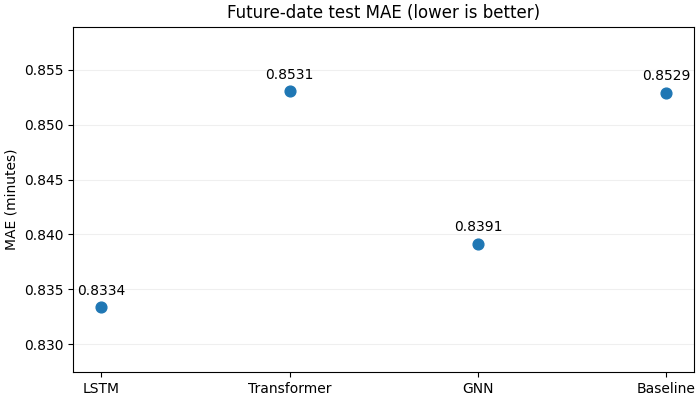
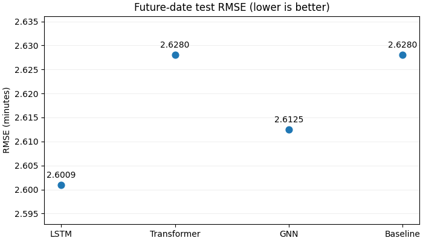

# Train-delay prediction

Can a neural network improve on predicting that a train's next arrival delay
will equal its previous departure delay? This project compares an **LSTM**,
**Transformer** and **graph neural network** against that baseline on later
service dates from Poland's PKP Intercity network.

The best model, the LSTM, reduced test MAE by **2.3%**. That is a modest gain of
about **1.18 seconds per stop in average absolute error**, while its mean bias
was worse. This demonstrates that looking at previous delays may be more suitable than a complex model due to its simplicity and negligible change in accuracy

## Recorded results

Errors are in minutes. These results use the same **85,097 held-out stops** from
**9–19 May 2026**, with seed 42 and checkpoints selected using validation MAE.

| Model | MAE ↓ | RMSE ↓ | P90 absolute error ↓ | Mean bias |
|---|---:|---:|---:|---:|
| LSTM | **0.8334** | **2.6009** | 2.0016 | -0.3817 |
| GNN | 0.8391 | 2.6125 | 2.0000 | -0.3191 |
| Previous-delay baseline | 0.8529 | 2.6280 | 2.0000 | -0.2672 |
| Transformer | 0.8531 | 2.6280 | 2.0002 | -0.2670 |

Negative bias means delays are underestimated. The Transformer is effectively
level with the baseline, and the P90 error is about two minutes for every model.
The small differences should not be interpreted as established statistical
significance: this full-data comparison uses one seed and one chronological test period.




The plots have separate, focused vertical scales; use their labels to judge the
size of the differences. Full scores, including R², are in
[comparison.csv](results/comparison.csv). The
[results notebook](notebooks/train_delay_comparison.ipynb) also shows the learning curves.

## Approach

- Reconstruct arrival delay as previous departure delay plus the recorded delay change.
- Remove duplicates, invalid labels and rows with imputed previous departure delays.
- Fit numerical imputation/scaling and category dictionaries on training rows only.
- Build history windows of up to 24 retained stops, including the target stop's
  known features while hiding its actual arrival delay.
- Train each model to predict a correction to the previous-delay baseline.
- Select checkpoints and reduce learning rates using validation MAE, then score
  the test period after training.

The LSTM reads ordered histories. The Transformer uses attention and position
embeddings. The GNN uses directed edges between consecutive matching route
stops, then combines the target stop with a pooled history. It represents each
journey's history separately and does not model simultaneous interactions between trains.

## Data and split

The [PKP Intercity delays dataset](https://zenodo.org/records/23283780), version 2,
by Marek Kostrz contains 558,334 tabular source rows. Cleaning the data results in **554,078**
usable stops remaining. The two gap dates exclude another **15,473** stops from the experiment.

| Split | Service dates in 2026 | Journeys | Stops |
|---|---|---:|---:|
| Training | March 1–April 26 | 22,760 | 377,960 |
| Validation | April 28–May 7 | 4,556 | 75,548 |
| Test | May 9–19 | 5,126 | 85,097 |

April 27 and May 8 are left unused to separate overnight journeys. Some source
dates are missing. The approximately 70%/15%/15% cutoffs are based on observed
service dates, not row counts. This is a project-specific chronological split.
See [data provenance and download instructions](data/README.md).

## Run locally

The recorded run used **Python 3.14 on Windows, CPU only**, with eight PyTorch
threads. Dependencies are pinned to the tested environment. A full training run
took about **2.6 hours** on the original laptop; runtime depends on hardware.

From this folder, create an environment and install the dependencies. On Windows:

```powershell
py -3.14 -m venv .venv
.venv\Scripts\python.exe -m pip install -r requirements.txt
.venv\Scripts\python.exe -m jupyter lab
```

Open `notebooks/train_delay_comparison.ipynb` to explore the saved results.
Its default run reads the included result files and does not download data or retrain.

To reproduce the experiment from a terminal:

```powershell
.venv\Scripts\python.exe scripts/download_data.py
.venv\Scripts\python.exe train.py --check
.venv\Scripts\python.exe train.py
```

On macOS/Linux, the equivalent environment commands use `python3 -m venv .venv`
and `.venv/bin/python`. Those platforms were not used for the recorded run.

New runs are saved to `runs/latest/`, leaving the included reference results in
`results/`. To change the training budget, use `python train.py --epochs 10` with
your environment's Python. `python train.py --help` lists the available options.

Training uses AdamW, gradient clipping, learning-rate reductions and early
stopping (20-epoch cap, patience 4, minimum 5 epochs). Starting settings:

| Model | Learning rate | Hidden width | Layers | Dropout | Epochs run / selected |
|---|---:|---:|---:|---:|---:|
| LSTM | 0.003 | 32 | 2 | 0.1 | 14 / 10 |
| Transformer | 0.003 | 32 | 2 | 0.1 | 10 / 6 |
| GNN | 0.001 | 16 | 1 | 0 | 16 / 12 |

The settings I used were carried over from an earlier preview experiment with a smaller dataset; this is not a new
full-data hyperparameter search. The settings are in `train_delay/training.py`.

## Files

```text
train_delay/
  data.py                  Cleaning, preprocessing and history batches
  models.py                Shared LSTM, Transformer and GNN implementation
  training.py              Training, evaluation, plots and result export
train.py                   Command-line entry point
notebooks/                 Results walkthrough and optional retraining
scripts/download_data.py   Versioned download with checksum verification
data/                      Dataset instructions and provenance
results/                   Recorded scores, plots, settings and verification
tests/                     Small checks that run without downloading the dataset
```

The notebook imports the Python modules, so there is one implementation of the
training and evaluation logic. To run the small checks after installation:

```sh
python -m unittest discover -s tests -v
```

## Limitations and next steps

The data covers March–May 2026 for one operator, so it does not establish
performance across seasons or other networks. Stops within a journey are
correlated. Repeated seeds, more chronological test periods and journey-level
uncertainty estimates would strengthen the comparison. The project uses a
selected feature set; live deployment would also need to verify when each
upstream feature becomes available.

Useful next experiments could be tree-based baselines, errors grouped by delay
severity, or a broader validation-only search. Training optimises MAE, which
helps explain why lower MAE does not guarantee better bias or P90 error.
